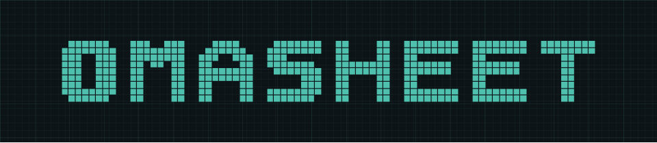
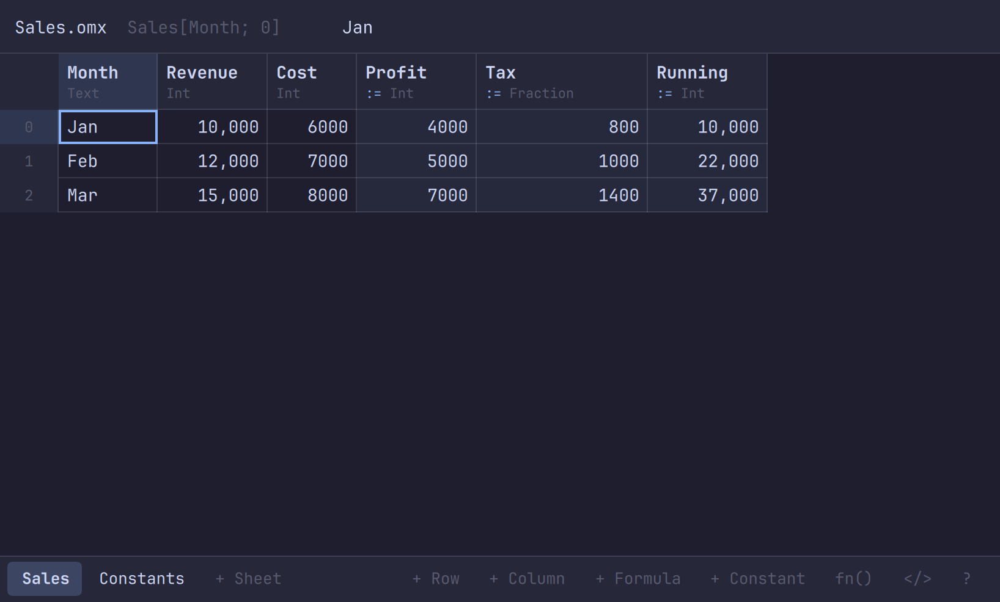

# Omasheet



What Markdown is to words, Omasheet is to numbers.

📄 **Text as the source of truth**

The spreadsheet as a trackable and composable document, not just a binary file. Great for Git version control and LLM workflow automation.

📊 **Columns as the computational model**

Named, typed columns and array expressions connect spreadsheet flexibility to structured dataframe querie and transformations.

🔢 **Exact decimal arithmetic as a semantic guarantee**

Numeric values retain their exact decimal meaning instead of floating-point
approximations: `0.1 + 0.2` is exactly `0.3`. Numbers are held the way Polars
holds them — a 64-bit `Int` and a 38-digit `Decimal` — so a value too wide to
hold is reported rather than quietly rounded. The last 8 of those 38 digits
are working room: held but neither compared nor shown, so that two ways of
reaching one number agree — `1/3 * 3` is `1` and `2/7 + 3/7 == 5/7` is true.
A `Fraction` column shows what it holds as a fraction, `1/7` and `2 3/4`.

_Automatically follows system dark/light mode._

```omx
const TaxRate = 20%

sheet Sales

| Month | Revenue | Cost | Profit | Tax | Running |
| ----- | ------- | ---- | ------ | --- | ------- |
| Jan   | 10000   | 6000 | *      | *   | *       |
| Feb   | 12000   | 7000 | *      | *   | *       |
| Mar   | 15000   | 8000 | *      | *   | *       |

Profit  := Revenue - Cost
Tax     := Profit * TaxRate
Running := [Revenue; 0..*].sum()
```



## Install

**From OmaStore** — Omasheet is listed under Office in
[OmaStore](https://github.com/KitsuneForgering/OmaStore), the community app
store for Omarchy. Search for it there and click `install`.

**macOS** (Apple silicon or Intel) installs `Omasheet.app` into `/Applications` and the `omasheet` command into `/usr/local/bin`:

```sh
curl -fsSL https://raw.githubusercontent.com/librasteve/omasheet/main/install.sh | bash
```

**Windows** (64-bit), in PowerShell: installs to `%LOCALAPPDATA%\Programs\Omasheet`, with a Start menu entry, `.omx` files opening in it, and `omasheet` on your PATH. No administrator needed.

```powershell
irm https://raw.githubusercontent.com/librasteve/omasheet/main/install.ps1 | iex
```

**Omarchy and Arch Linux, with pacman** (the same `install.sh` line as for macOS):

```sh
curl -fsSL https://raw.githubusercontent.com/librasteve/omasheet/main/install.sh | bash
```

**Update:** run the same line again.
**Uninstall:** `sudo pacman -R omasheet` on Arch; on macOS delete `/Applications/Omasheet.app` and `/usr/local/bin/omasheet`; on Windows run `uninstall.ps1` in the install folder, or use Apps & features.

**Build from source** (other Linux, or to hack on it): install Qt 6 and Rust 
(`brew install qt rust`), then `cargo build --release --package omasheet-ui`; 
the binary is at `target/release/omasheet`.

Building directly from the git repo instead of a local clone needs `--locked`
(`cargo install --git https://github.com/librasteve/omasheet --locked omasheet-ui`),
since omasheet depends on a crate whose compatible releases are all yanked, and
only the version pinned in this repo's `Cargo.lock` can still be resolved.

## Run

```sh
omasheet                                # the app, on a new file
omasheet examples/budget.omx            # the app, on a .omx, .csv, .json or .xlsx file
omasheet print examples/budget.omx      # print the calculated file
omasheet eval '1/3 + 1/6'               # 0.5, exactly
omasheet export examples/budget.omx --xlsx [or --csv | --json | --parquet]
omasheet render examples/report.md --html
omasheet render examples/showcase/short-report.md --html   # no .omx file, the sheet is in the Markdown
```

## AI Skill

Prompt your favorite AI with:

```text
Please load the Omasheet skill from https://raw.githubusercontent.com/librasteve/omasheet/main/skill/omasheet/SKILL.md and follow its instructions when creating, checking, or converting spreadsheets.
```

The Arch package also installs the skill to `/usr/share/omasheet/agent-skill/omasheet`. To give it to Claude Code:

```sh
ln -sfn /usr/share/omasheet/agent-skill/omasheet ~/.claude/skills/omasheet
```

## OmaStore

Omasheet is listed in OmaStore for Omarchy: [omastore://librasteve/omasheet](omastore://librasteve/omasheet)

## Docs

- [The file format](docs/format.md)
- [OMX in brief](docs/omx.md) — the language's grammar on one page
- [Expressions](docs/expressions.md)
- [The app and the command line](docs/app.md)
- [XLSX, CSV, JSON and Markdown](docs/interop.md)
- [`examples/`](examples) — worked files, each with its expected output
- [`openspec/`](openspec) — the design and the specs

**Breaking change in 0.1.6.** Numbers are now the Polars dtypes, so exactness narrows from rational to a 38-digit decimal: `Int` is 64-bit rather than arbitrary-precision, and a result that does not fit is reported. `Complex` was dropped and has since returned (the most infectious number type, stored in Parquet as a struct of `re` and `im`), and the type names follow Polars: `Bool` is `Boolean`, `Text` is `String`, `Num` is `Float`, and an empty cell is `Null`. Files written for 0.1.5 and earlier may need their schema lines renamed.

Early and changing. MAY CONTAIN ERRORS.

Copyright (c) 2026 Stephen Roe. MIT licence; see [LICENSE](LICENSE).
