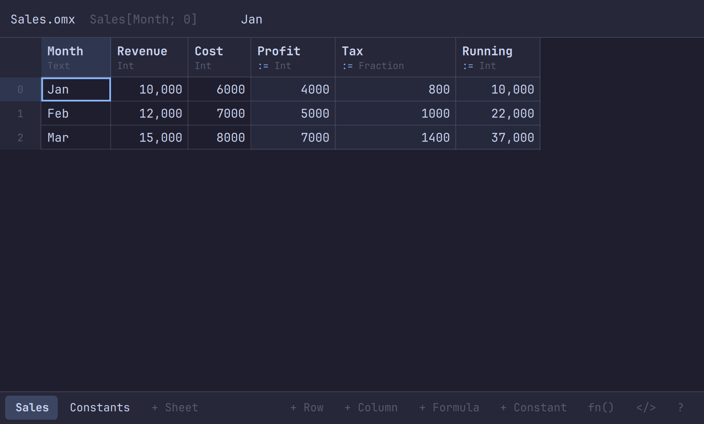
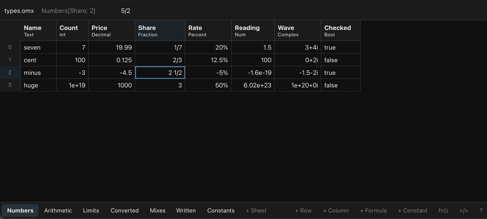
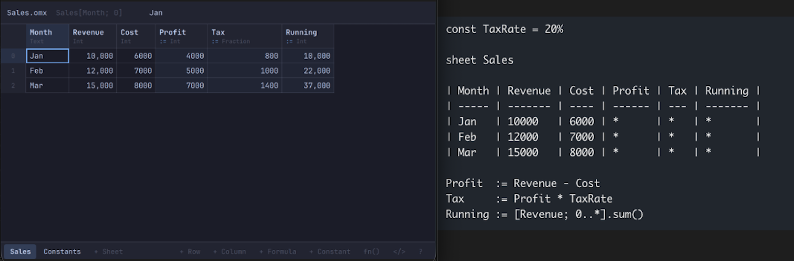

<p align="center">
  
</p>

# Omasheet

**What Markdown is to words, Omasheet is to numbers.** A plain-text spreadsheet with SI units, exact arithmetic and typed columns, in files you can diff, review and hand to an AI.

[](https://github.com/librasteve/omasheet/actions/workflows/ci.yml)
[](https://github.com/librasteve/omasheet/releases/latest)
[](LICENSE)

[Website](https://omasheet.org) · [Install](#install) · [Run](#run) · [Docs](#docs) · [Releases](https://github.com/librasteve/omasheet/releases)

<a href="Screenshot.png"></a>

The app on macOS, Windows, Arch and Omarchy follows your system dark and light mode.

## Why Omasheet

### The file is the spreadsheet

An `.omx` file holds constants, functions and sheets as readable text. It diffs cleanly in Git, reviews like code, and is easy for an LLM to read and write. A formula is written once per column and applies down every row, so a sheet reads like a small, typed program over its own data.

```omx
const TaxRate = 20%

sheet Sales

| Month | Revenue | Cost | Profit | Tax | Running |
| ----- | ------- | ---- | ------ | --- | ------- |
| Jan   | 10000   | 6000 | *      | *   | *       |
| Feb   | 12000   | 7000 | *      | *   | *       |
| Mar   | 15000   | 8000 | *      | *   | *       |

Profit  := Revenue - Cost
Tax     := Profit * TaxRate
Running := [Revenue; 0..*].sum()
```

### Numbers that know their dimensions

Write `5kg + 300g` and get `5.3kg`. Add a mass to a length and you get an error that says so, not a meaningless number. All the SI prefixes work on every unit, angles and time are quantities too, and uncertainty (`5kg ± 100g`) carries through your arithmetic.

```sh
$ omasheet eval '5kg + 300g'
5.3kg
$ omasheet eval '5kg + 3m'
<expression>:1:1: error: cannot add kg and m: they measure Mass and Length
```

### Exact where it counts

The numeric types form a hierarchy, **ℤ ⊂ ℚ ⊂ ℝ ⊂ ℂ**. The more _infectious_ a type, the less exact it is: `Integer` < `Fraction` < `Decimal` < `Float` < `Scientific` < `Complex`. A `Fraction` is exact without limit, whereas a `Decimal` is held to a fixed number of places. `Float` trades exactness for exponential range, `Scientific` provides uncertainty for physical constants and `Complex` has _real_ and _imaginary_ parts. Other types cover `Quantity`, `String`, `Datetime`, `Zoned`, `Boolean` and representations such as `Percent`, `Hex` and `Binary`.

<a href="docs/images/types.png"></a>

### Markdown in, finished report out

Put a sheet inside a Markdown document and render it to HTML with the same displays as the grid, so the numbers and the prose stay in one reviewable file.

<a href="docs/images/spreadmeetsmd.png"></a>

### Built for scripts and AI agents

Columns map to dataframe-style queries and transformations, run by Polars, including windowed columns such as `cum_sum`, `diff`, `rank` and `rolling_mean`. Everything the app does is on the command line, and an [agent skill](#ai-skill) lets Claude and friends write `.omx` files that type-check.

### And more

- **Interchange.** Import and export XLSX, CSV, JSON and Parquet, with types and units kept where the format allows.
- **Built-in constants.** `pi`, `c`, `planck`, `kB`, `NA` and more, from the 2019 SI and CODATA 2022.
- **Booleans and logic.** Symbol formats such as `✓✗`, logic functions and gate operators, set right in the grid.
- **Native.** One Rust binary, with a Qt app on macOS, Windows, Arch and Omarchy.

## Install

**From OmaStore** — Omasheet is listed under Office in
[OmaStore](https://github.com/KitsuneForgering/OmaStore), the community app
store for Omarchy. Search for it there and click `install`.

**Omarchy and Arch Linux, with pacman** (the same `install.sh` line as for macOS):

```sh
curl -fsSL https://raw.githubusercontent.com/librasteve/omasheet/main/install.sh | bash
```

**Update:** run the same line again.
**Uninstall:** `sudo pacman -R omasheet` on Arch; on macOS delete `/Applications/Omasheet.app` and `/usr/local/bin/omasheet`; on Windows run `uninstall.ps1` in the install folder, or use Apps & features.

**macOS** (Apple silicon or Intel) open Terminal app and use the same `curl` line; installs `Omasheet.app` into `/Applications` and the `omasheet` command into `/usr/local/bin`.

**Windows** (64-bit), in PowerShell: installs to `%LOCALAPPDATA%\Programs\Omasheet`, with a Start menu entry, `.omx` files opening in it, and `omasheet` on your PATH. No administrator needed.

```powershell
irm https://raw.githubusercontent.com/librasteve/omasheet/main/install.ps1 | iex
```

**Build from source** (other Linux, or to hack on it): install Qt 6 and Rust 
(`brew install qt rust`), then `cargo build --release --package omasheet-ui`; 
the binary is at `target/release/omasheet`.

## Run

```sh
omasheet                                # the app, on a new file
omasheet examples/budget.omx            # the app, on a .omx, .csv, .json or .xlsx file
omasheet print examples/budget.omx      # print the calculated file
omasheet eval '1/3 + 1/6'               # 1/2, exactly
omasheet export examples/budget.omx --xlsx [or --csv | --json | --parquet]
omasheet render examples/report.md --html
omasheet render examples/showcase/short-report.md --html   # no .omx file, the sheet is in the Markdown
```

## AI Skill

Prompt your favorite AI with:

```text
Please load the Omasheet skill from https://raw.githubusercontent.com/librasteve/omasheet/main/skill/omasheet/SKILL.md and follow its instructions when creating, checking, or converting spreadsheets.
```

The Arch package also installs the skill to `/usr/share/omasheet/agent-skill/omasheet`. To give it to Claude Code:

```sh
ln -sfn /usr/share/omasheet/agent-skill/omasheet ~/.claude/skills/omasheet
```

## Docs

- [The file format](docs/format.md)
- [OMX in brief](docs/omx.md) — the language's grammar on one page
- [Expressions](docs/expressions.md)
- [The app and the command line](docs/app.md)
- [XLSX, CSV, JSON and Markdown](docs/interop.md)
- [`examples/`](examples) — worked files, each with its expected output
- [`openspec/`](openspec) — the design and the specs

**Breaking change in 0.1.6.** Numbers are now the Polars dtypes, so exactness narrows from rational to a 38-digit decimal: `Int` is 64-bit rather than arbitrary-precision, and a result that does not fit is reported. `Complex` was dropped and has since returned (the most infectious number type, stored in Parquet as a struct of `re` and `im`), and the type names follow Polars: `Bool` is `Boolean`, `Text` is `String`, `Num` is `Float`, and an empty cell is `Null`. Files written for 0.1.5 and earlier may need their schema lines renamed.

## Status

Early and changing, and it may contain errors. Please [open an issue](https://github.com/librasteve/omasheet/issues) if a number surprises you.

## Licence

MIT. Copyright (c) 2026 Stephen Roe. See [LICENSE](LICENSE).
