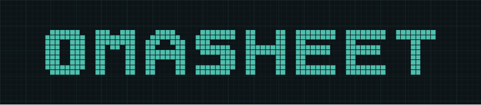
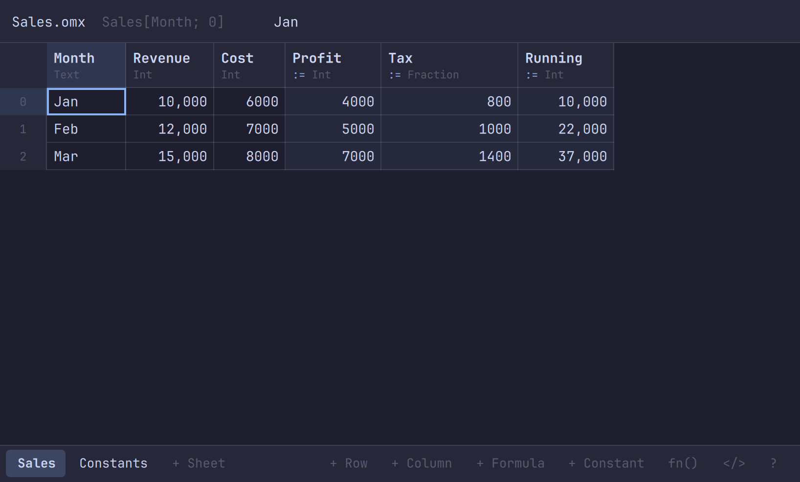

# Omasheet



What Markdown is to text, Omasheet is to numbers.

📄 **Text as the source of truth**

The spreadsheet becomes a readable, diffable and composable document, not just a binary workbook.

📊 **Columns as the computational model**

Named, typed data and array expressions connect spreadsheet authoring to dataframe-style transformations.

🔢 **Exact arithmetic as a semantic guarantee**

Numeric values retain their exact decimal or rational meaning instead of floating-point approximations.

_Automatically follows system dark/light mode._

```omx
const TaxRate = 20%

sheet Sales

Month | Revenue | Cost | Profit | Tax | Running
Jan   | 10000   | 6000 | *      | *   | *
Feb   | 12000   | 7000 | *      | *   | *
Mar   | 15000   | 8000 | *      | *   | *

Profit  := Revenue - Cost
Tax     := Profit * TaxRate
Running := [Revenue; 0..*].sum()
```



## Install

```sh
curl -fsSL https://raw.githubusercontent.com/librasteve/omasheet/main/install.sh | bash
```

**Update:** run the same line again.
**Uninstall:** `sudo pacman -R omasheet`.

## Run

```sh
omasheet                                # the app, on a new file
omasheet examples/budget.omx            # the app, on a .omx, .csv, .json or .xlsx file
omasheet print examples/budget.omx      # print the calculated file
omasheet eval '1/3 + 1/6'               # 0.5, exactly
omasheet export examples/budget.omx --xlsx [or --csv | --json]
omasheet render examples/report.md --html
```

## AI Skill

Prompt your favorite AI with:

```text
Please load the Omasheet skill from https://raw.githubusercontent.com/librasteve/omasheet/main/.claude/skills/omasheet/SKILL.md and follow its instructions when creating, checking, or converting spreadsheets.
```

## Docs

- [The file format](docs/format.md)
- [Expressions](docs/expressions.md)
- [The app and the command line](docs/app.md)
- [XLSX, CSV, JSON and Markdown](docs/interop.md)
- [`examples/`](examples) — worked files, each with its expected output
- [`openspec/`](openspec) — the design and the specs

Early and changing. MAY CONTAIN ERRORS.

Copyright (c) 2026 Stephen Roe. MIT licence; see [LICENSE](LICENSE).
