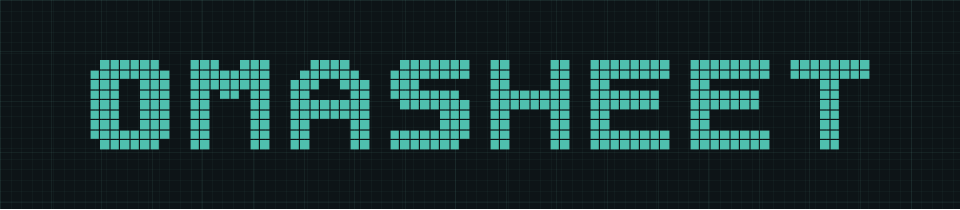
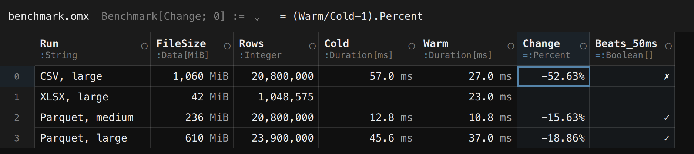
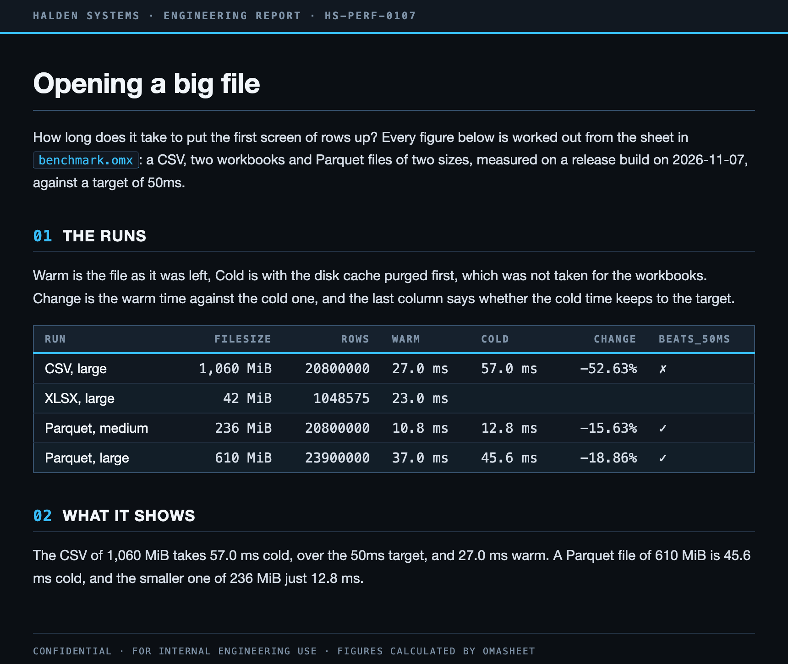

<p align="center">
  
</p>

# Omasheet

**What Markdown is to words, Omasheet is to numbers.** A plain-text spreadsheet with SI units, exact arithmetic and typed columns, in files you can diff, review and hand to an AI.

[](https://github.com/librasteve/omasheet/actions/workflows/ci.yml)
[](https://github.com/librasteve/omasheet/releases/latest)
[](LICENSE)

[Website](https://omasheet.org) · [Install](#install) · [Run](#run) · [Docs](#docs) · [Releases](https://github.com/librasteve/omasheet/releases)


<a href="docs/images/screenshot.png"></a>

Omarchy first · your theme · keys or mouse · built on Polars · macOS · Windows · Linux · Rust · MIT

### Support

Omasheet is free and MIT licensed. If it is useful to you, please help keep it going. Your support is appreciated.

[♥ Donate](https://github.com/sponsors/librasteve) · [Support on Patreon](https://www.patreon.com/cw/librasteve/membership) · [★ Star it on GitHub](https://github.com/librasteve/omasheet)


### The plain-text spreadsheet

An `.omx` file holds constants, functions and sheets as readable text. It diffs cleanly in Git, reviews like code, and is easy for an LLM to read and write. A formula is written once per column and applies down every row, so a sheet reads like a small, typed program over its own data.

```omx
const Target = 50

sheet Benchmark

| Run             | FileSize | Rows     | Cold | Warm | Change | Beats_50ms |
| --------------- | -------- | -------- | ---- | ---- | ------ | ---------- |
| CSV, large      | 1060     | 20800000 | 57   | 27   | *      | *          |
| XLSX, large     | 42       | 1048575  |      | 23   | *      | *          |
| Parquet, medium | 236      | 20800000 | 12.8 | 10.8 | *      | *          |
| Parquet, large  | 610      | 23900000 | 45.6 | 37   | *      | *          |

Change := (Warm/Cold-1).Percent
Beats_50ms := Cold <= Target
```

### Numbers that know their dimensions

Write `5kg + 300g` and get `5.3kg`. Add a mass to a length and you get an error that says so, not a meaningless number. All the SI prefixes work on every unit, angles and time are quantities too, and uncertainty (`5kg ± 100g`) carries through your arithmetic.

```text
> 5kg±100g + 300g
5.30(10)kg
> 9.81m.s^-2 * 2s
19.62m⋅s⁻¹
> sin(45°30′30″)
0.713·
> €100.to('$')
109.673USD·
> 5kg + 3m
error: cannot add kg and m: they measure Mass and Length
```

### Exact where it counts

Fractions are exact without limit, Decimals keep money to the penny, and scientific notation carries uncertainty. From `1/3 + 1/6 == 1/2` to physical constants such as **G**: `6.67430(15)e-11 m³⋅kg⁻¹⋅s⁻²`, numbers mean what they say.

| Type | Group | Literal | Representations |
|---|---|---|---|
| `Integer` | ℤ | `1` | `0xff`, `0o17`, `0b101` |
| `Fraction` | ℚ | `<1/7>` | `1/7`, `2 3/4` |
| `Decimal` | ℚ | `1.0` | `14.29%` |
| `Float` | ℝ | `1e0` | - |
| `Scientific` | ℝ | `1.01(01)e0` | `1 ± 0.01` |
| `Complex` | ℂ | `3+4i` | - |

`Integer`, `Fraction` and `Decimal` are exact, and each type is more infectious than the one above it: an operation gives the least number system that holds its operands. Other types cover `Quantity`, `String`, `Datetime`, `Zoned` and `Boolean`.

### Markdown in, finished report out

Put a sheet inside a Markdown document and render it to HTML with the same displays as the grid, so the numbers and the prose stay in one reviewable file.

Have your AI run this on every build, apply a theme, save to the repo and post to your intranet or email the team.

<a href="docs/images/benchmarks-report.png"></a>

### Built for scripts and AI agents

Filter, `sort`, `group_by`, `agg`, `select`, `apply`, etc. run as Polars queries with streaming and lazy execution. Everything the app does is on the command line, and an [agent skill](#ai-skill) lets Claude and friends write `.omx` files that type-check.

### And more

- **Interchange.** Import and export XLSX, CSV, JSON and Parquet, with types and units kept where the format allows.
- **Built-in constants.** `pi`, `c`, `planck`, `kB`, `NA` and more, from the 2019 SI and CODATA 2022.
- **Booleans and logic.** Symbol formats such as `✓✗`, logic functions and gate operators, set right in the grid.
- **Native.** One Rust binary, with a Qt app on macOS, Windows, Arch and Omarchy.

## Install

**Omarchy and Arch Linux, with pacman** (the same `install.sh` line as for macOS):

```sh
curl -fsSL https://raw.githubusercontent.com/librasteve/omasheet/main/install.sh | bash
```

**Update:** run the same line again.
**Uninstall:** `sudo pacman -R omasheet` on Arch; on macOS delete `/Applications/Omasheet.app` and `/usr/local/bin/omasheet`; on Windows run `uninstall.ps1` in the install folder, or use Apps & features.

**From OmaStore** — Omasheet is listed under Office in
[OmaStore](https://github.com/KitsuneForgering/OmaStore), the community app
store for Omarchy. Search for it there and click `install`.

**macOS** (Apple silicon or Intel) open Terminal app and use the same `curl` line; installs `Omasheet.app` into `/Applications` and the `omasheet` command into `/usr/local/bin`.

**Windows** (64-bit), in PowerShell: installs to `%LOCALAPPDATA%\Programs\Omasheet`, with a Start menu entry, `.omx` files opening in it, and `omasheet` on your PATH. No administrator needed.

```powershell
irm https://raw.githubusercontent.com/librasteve/omasheet/main/install.ps1 | iex
```

**Build from source** (other Linux, or to hack on it): install Qt 6 and Rust 
(`brew install qt rust`), then `cargo build --release --package omasheet-ui`; 
the binary is at `target/release/omasheet`.

## Run

```sh
omasheet                                # the app, on a new file
omasheet examples/budget.omx            # the app, on a .omx, .csv, .json, .xlsx or .parquet file
omasheet print examples/budget.omx      # print the calculated file
omasheet eval '1/3 + 1/6'               # 1/2, exactly
omasheet export examples/budget.omx --xlsx [or --csv | --json | --parquet]
omasheet render examples/report.md --html
omasheet render examples/showcase/short-report.md --html   # no .omx file, the sheet is in the Markdown
```

## AI Skill

Prompt your favorite AI with:

```text
Please load the Omasheet skill from https://raw.githubusercontent.com/librasteve/omasheet/main/skill/omasheet/SKILL.md and follow its instructions when creating, checking, or converting spreadsheets.
```

The Omarchy package also installs the skill to `/usr/share/omasheet/agent-skill/omasheet`. To give it to Claude Code:

```sh
ln -sfn /usr/share/omasheet/agent-skill/omasheet ~/.claude/skills/omasheet
```

## Docs

- [The file format](docs/format.md)
- [OMX in brief](docs/omx.md) — the language's grammar on one page
- [Expressions](docs/expressions.md)
- [The app and the command line](docs/app.md)
- [XLSX, CSV, JSON and Markdown](docs/interop.md)
- [`examples/`](examples) — worked files, each with its expected output
- [`openspec/`](openspec) — the design and the specs

## Status

Early and changing, and it may contain errors. Please [open an issue](https://github.com/librasteve/omasheet/issues) if a number surprises you.

## Licence

MIT. Copyright (c) 2026 Stephen Roe. See [LICENSE](LICENSE).
